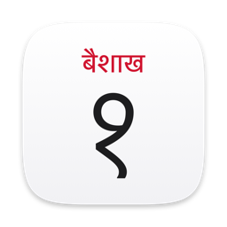
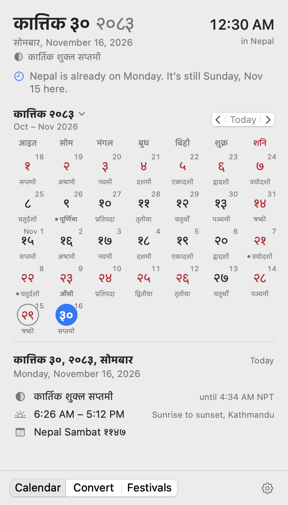
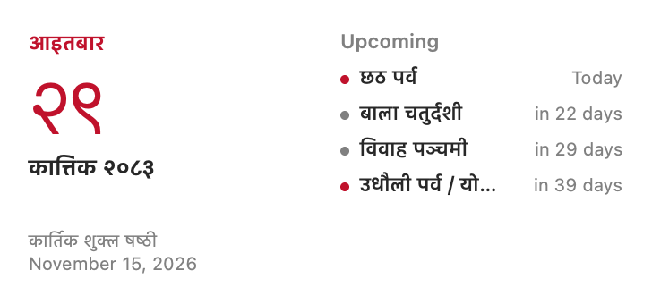

<p align="center">
  
</p>

<h1 align="center">Nepali Patro</h1>

<p align="center">
  A Nepali (Bikram Sambat) calendar for the macOS menu bar that follows <b>Nepal time</b>.<br>
  Festivals, tithi, a date converter, and desktop widgets. Works offline, with no tracking.
</p>

<p align="center">
  <code>brew install --cask officialbishal/tap/nepali-patro</code>
</p>

<p align="center">
  
  &nbsp;
  
</p>

---

## Why another Nepali calendar?

Most Nepali calendar apps work out "today" from your Mac's clock. If you live outside Nepal, say in the US, the Nepali date in your menu bar stays on yesterday for half a day. Nepal moves to the next day at midnight Nepal time, which is 1:15 PM in New York and 10:15 AM in California, but the app waits for your own midnight.

**Nepali Patro uses Nepal Standard Time (UTC+05:45) by default.** The menu bar, calendar, and widgets change at midnight in Nepal, wherever you are. When Nepal and your Mac are on different dates, the app tells you: *"New day in Nepal. It's still Sun, Nov 15 here."* If you'd rather follow your local clock, you can switch with one setting.

## Features

- **Menu bar date**: `कात्तिक २९`, `२९ कात्तिक, आइत`, `२०८३/०७/२९`, a calendar icon, and more, with the time in Nepal if you want it.
- **The month, the way a patro prints it**: Nepali dates with the English date in the corner, the tithi for each day, holidays and Saturdays in red, and a small marker on festival days. When Nepal and your Mac are on different dates, your local date gets a thin ring.
- **Tithi and panchang**: the tithi with its end time, sunrise and sunset in Kathmandu, and the Nepal Sambat year.
- **Festivals and holidays**: Dashain, Tihar, Chhath, Teej, Lhosars, Eid, and more. These are worked out from astronomy and the rules Nepali patros use, then checked against the Government of Nepal's holiday lists for 2082 and 2083 BS (see [accuracy](#accuracy)).
- **Date converter** for AD and BS in both directions, 1975–2100 BS (1918–2044 AD).
- **Upcoming festivals** grouped by month, with a "holidays only" filter.
- **Festival reminders**: on the day at a time you choose, and the evening before if you like.
- **Apple Calendar**: your own events appear under the selected day, and one click writes Nepali festivals into a "Nepali Festivals" calendar. You can also export a `.ics` file or copy a feed URL for Google Calendar or Outlook.
- **Desktop widgets**: today's date (small and medium) and the full month (large). They also follow Nepal time.
- **Two separate languages**: an English interface with Nepali dates, a fully Nepali interface, or English throughout. The interface language and the calendar language are independent settings.
- **Native look**: a system popover (Liquid Glass on macOS 26), a standard Settings window, Light, Dark or Auto, and seven accent colors. Red is never an accent, because in a patro red means a holiday.
- **Keyboard shortcuts**: ← → change month, ↑ ↓ change year, `T` goes to today, `⌘1`–`⌘3` switch pages, `⌘,` opens Settings, Esc closes.
- **`patro` command-line tool**, installed with the app:

```console
$ patro
कात्तिक २९, २०८३, आइतबार
Sunday, November 15, 2026
कार्तिक शुक्ल षष्ठी
• छठ पर्व (बिदा)
नेपाल समय: १०:११ PM

$ patro upcoming 3 --en
Kartik 29    Nov 15   Chhath ★  (Today)
Mangsir 21   Dec 7    Bala Chaturdashi  (in 22 days)
Mangsir 28   Dec 14   Vivah Panchami  (in 29 days)

$ patro bs2ad 2083-07-22 --en      # also: ad2bs, month, events, ics
```

<p align="center">
  
  
</p>
<p align="center">
  
</p>
<p align="center">
  
  
</p>

It has no network access, no analytics, and no account. The app is a few MB and runs entirely offline. The only network request is an optional daily update check against GitHub Releases.

## Install

### Homebrew (recommended)

```sh
brew install --cask officialbishal/tap/nepali-patro
```

Upgrade with `brew upgrade --cask nepali-patro`.

The app is ad-hoc signed rather than notarized by Apple, so the cask clears the download quarantine flag for you. You don't need `sudo xattr`.

### Manual

Download the latest `NepaliPatro-x.y.z.dmg` from [Releases](https://github.com/OfficialBishal/nepali-patro/releases/latest) and drag **Nepali Patro** to Applications. Then run this once:

```sh
xattr -dr com.apple.quarantine "/Applications/Nepali Patro.app"
```

Requires macOS 14 Sonoma or later, on Apple silicon or Intel.

### Widgets

Open the app once, then right-click the desktop, choose **Edit Widgets…**, and search for "Nepali".

## Subscribe from any calendar app

The festival calendar is also published as an iCalendar feed that works with Google Calendar, Outlook, and others:

- English: `https://raw.githubusercontent.com/OfficialBishal/nepali-patro/main/calendar/nepali-festivals.ics`
- नेपाली: `https://raw.githubusercontent.com/OfficialBishal/nepali-patro/main/calendar/nepali-festivals-ne.ics`

## Accuracy

- **BS ↔ AD conversion** uses the standard month-length table for 1975–2100 BS. It is cross-checked against two independent open datasets and against computed solar ingresses (sankranti).
- **Tithi** is the one in force at sunrise in Kathmandu, as printed in Nepali patros. It is computed with the Moon and Sun theories from Meeus' *Astronomical Algorithms*, and full and new moon times come out within about a minute.
- **Lunar festivals** follow the patro rules. The tithi is usually taken at sunrise (udaya), with the traditional exceptions: Maha Navami at midday, Vijaya Dashami and Ghode Jatra in the afternoon, Laxmi Puja and Chhath at sunset, and Shivaratri at midnight. Adhik (leap) months are skipped. Every festival in the 2082 and 2083 BS government holiday lists comes out on the right day (see `swift run PatroChecks`).
- **Things that can differ**: Eid follows moon sighting and may move by a day. Tibetan-calendar Lhosars are approximated by their lunar month. The government can also declare extra holidays. If you spot a wrong date, please [open an issue](https://github.com/OfficialBishal/nepali-patro/issues).

## Build from source

You only need the Xcode Command Line Tools.

```sh
git clone https://github.com/OfficialBishal/nepali-patro && cd nepali-patro
swift run PatroChecks          # run the self-checks
./scripts/build.sh             # → dist/Nepali Patro.app and dist/NepaliPatro-<version>.dmg
```

| Target | What it is |
| --- | --- |
| `PatroCore` | Calendar data, BS↔AD conversion, Nepal-time "today", astronomy, tithi, festival engine, ICS |
| `PatroUI` | Shared SwiftUI pieces (color palette, month grid) |
| `NepaliPatro` | The menu bar app |
| `NepaliPatroWidgets` | The WidgetKit extension |
| `patro` | The command-line tool |
| `PatroChecks` | Self-checks: conversions, the Nepal-midnight flip, and official holiday dates |

Design decisions are documented in [DESIGN.md](DESIGN.md) and the product brief in [PRODUCT.md](PRODUCT.md).

## License

MIT © Bishal Shrestha
